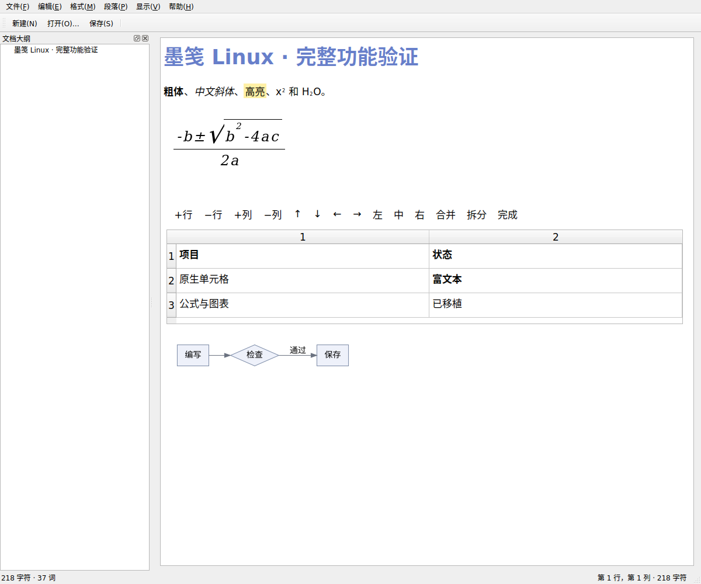
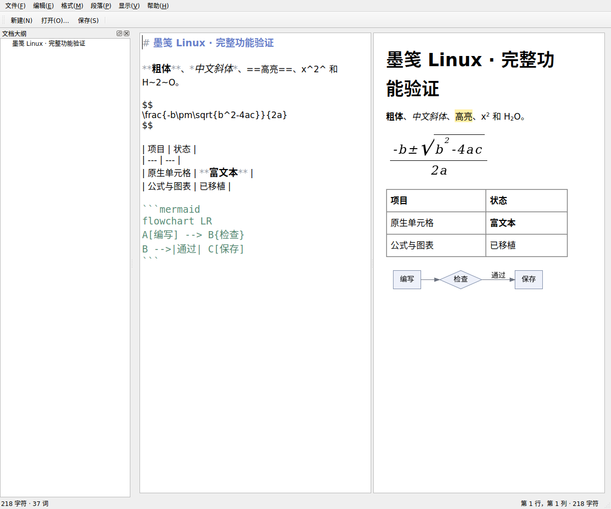

# 墨笺 Mojian for Linux

原生 C++17 / Qt 6 Markdown 编辑器，提供源码保留的实时排版、内嵌富文本表格、数学公式、图表和离线中文帮助。支持 Ubuntu 与 Arch Linux。

## 功能

- 实时编辑、源码、源码/预览分栏、阅读四种模式。
- 内嵌原生表格：富文本、行列操作、对齐、合并拆分、键盘导航和共同撤销。
- 固定版本 cmark / cmark-gfm 严格模式，以及脚注、提示、目录、高亮等扩展。
- 常用数学公式、本地宏、六类图表、图片与主动上传。
- 原子保存、文件冲突保护、定时恢复、正则/选区替换。
- 大纲、文件树、主题、拼写检查、七语界面，F1 离线中文帮助。
- 原生 PDF/书签、RTF、HTML、文本、打印；Pandoc 提供额外文档转换。

## 界面





## 构建

需要 CMake 3.20+、C/C++17、Qt 6.4+ Widgets、PrintSupport、Network、Svg、DBus、Xml、Concurrent。测试另需 Qt Test。

```sh
cmake -S . -B build -DCMAKE_BUILD_TYPE=Release
cmake --build build --parallel 2
./build/mojian
```

用户级安装：`sh scripts/install-user.sh`。Ubuntu/Arch 原生包配置见 [打包说明](packaging/README.md)。

增强组件：Graphviz、Hunspell、secret-tool/Secret Service、pdftotext 和 Pandoc。它们分别提供图表布局、拼写、安全令牌、书签位置和文档转换。

## 测试

```sh
QT_QPA_PLATFORM=offscreen ./build/mojian_tests
QT_QPA_PLATFORM=offscreen ./build/mojian_parity_tests
python3 scripts/test-x11.py
```

完整回归需要 Pandoc、Hunspell；X11 集成另需 Xvfb、xdotool。集成脚本使用独立显示、配置、数据和运行目录。

## 覆盖范围

原生排版与浏览器 HTML/CSS 的表现存在差异。数学与图表覆盖常用语法，不是全部 TeX/MathJax/Mermaid。未知复杂语法保留源码。严格标准集验证的是解析及 HTML 序列化。详见 [验证记录](docs/VALIDATION.md) 和 [中文帮助](resources/help-zh-CN.md)。

## 第三方组件

cmark、cmark-gfm、SCOWL 词典及标准测试数据保留其原始许可证。详见 [第三方声明](resources/ThirdPartyNotices.txt) 和各 Vendor/COPYING 文件。Qt、Graphviz、Hunspell 和 Pandoc 为各自独立许可的运行依赖。

项目自身的代码、文档、打包配置及已授权图标采用 [Apache License 2.0](LICENSE)。第三方组件保留原许可，参见 [NOTICE](NOTICE)。
